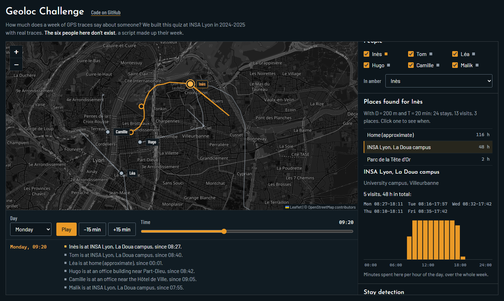

# Geoloc Challenge

A privacy awareness challenge from a school project at INSA Lyon. You follow six people through a week in Lyon on a map, the page finds the places where they stay, and a quiz asks eight questions that their GPS traces answer: where Camille lives, who cycles to work, whose lost phone took a photo on Place Saint-Jean. The six people don't exist. A seeded script makes up their week, because real location data identifies real people.

Live page: https://swan-maillard.github.io/geoloc-challenge/



## The project

Geoloc Challenge was our P-SAT (Projet Scientifique, Artistique et Technique) at INSA Lyon in 2024-2025. We were four: Martin Nizon-Deladoeuille, Tiphaine Raugel, Charles-François St-Cyr and me, supervised by Antoine Boutet. We built a web app with two parts: a visualisation tool (pick people and a day, scrub through time on an OpenStreetMap map, click a point of interest for its address, place type, hourly activity and a StreetView image) and a quiz of 16 questions, each with two hints and a short text after the answer about why that inference matters.

It ran on real data: 34.5 million GPS fixes from 69 people, collected by the Priva'Mov crowdsensing campaign in Lyon between October 2014 and January 2016. We kept 10 people over 12 common days (4 to 15 March 2015), 1,116,608 fixes in all. Points of interest came from time and position (adapted from an earlier Inria project) and were enriched with OpenStreetMap. The stack was a Python API (pandas, NumPy), a React and TypeScript front end, CSV files, Docker and Nginx.

We tested it in the fifth-year privacy course at INSA and showed it to someone from the CNIL. They liked it, but warned that the participants could be re-identified from their traces. Our report suggested generated data as a fix. The code of the school version is in a private repository on Inria's GitLab.

## What this demo shows

- A Leaflet map of the week. Tick the people to show, put one in amber, pick a day and move the time slider (or press play) to see where everyone is and the trace so far. A side panel says in words what's on the map: who is where, since when, and how fast someone is moving.
- Stay-point detection in TypeScript. A stay is a run of fixes within D metres of the first one for at least T minutes. Stays at the same spot less than 30 minutes apart are merged into one visit, and visits within D metres become one place. D and T are sliders (200 m and 20 min by default), so you can watch places split, merge or vanish.
- Each place shows its label, visit times and an hourly activity chart.
- The quiz: 8 questions in the spirit of our 16, from easy (where does Camille live) to harder (who drove past a speed camera at 94 km/h). Two hints each, an explanation after each answer and a score at the end.

## Differences with the school version

This page rebuilds the idea. The school version's code is private and its data belongs to real people, so:

- The data is generated. `src/data/generate.ts` makes up six people and their week from routines between public places (INSA Lyon at La Doua, Part-Dieu, Bellecour, Croix-Rousse, Place Saint-Jean, a climbing gym in Gerland, the Théâtre de la Croix-Rousse, Groupama Stadium, a day trip to Paris). Homes are points in residential areas, shown only as "home (approximate)". The log has noise, phones that stop logging for a while, no signal in the metro or for part of the train ride, and a few fixes a kilometre off.
- I wrote the stay-point detection from the textbook method (Li et al., 2008), not from our old code.
- Places get their labels from the generator's list of places instead of OpenStreetMap, and there's no StreetView.
- The questions are new and only use the generated week. Each answer is checked in the tests by working it out from the traces (stays, places, speeds, times), not by reading it from the generator.
- Everything runs in the browser. There's no API.
- The map uses standard OpenStreetMap tiles, turned grey and dark with a CSS filter.

## Run it

```sh
npm install
npm run dev
npm test
```

`npm run generate` writes the week to `generated/traces.csv` in the same layout as the Priva'Mov files (id, timestamp, lon, lat) and prints the places found for each person. Pass a number to try another seed: `npm run generate -- 7`.
